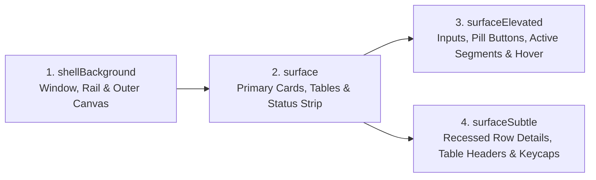

import {
  ColorSwatch,
  GradientBanner,
  GradientBannerGrid,
} from '@site/src/components/ColorSwatch';

# Branding & Design System

This guide is the canonical reference for **Syrius** visual identity, semantic color tokens, gradients, typography, desktop layout patterns, and WCAG AA+ accessibility standards across the Flutter desktop wallet and Zenon ecosystem web properties.

:::info Source of Truth & Web Parity
- **Flutter Desktop Wallet**: All 32 semantic dark and light tokens live in `SyriusThemeTokens` (`lib/rearchitecture/utils/theming/syrius_theme_tokens.dart`), introduced with the desktop UI redesign (`feat/syrius-ui-reskin`), alongside Material 3 themes (`newLightTheme` and `newDarkTheme` in `lib/rearchitecture/utils/theming/new_app_themes.dart`) and reusable primitives under `lib/rearchitecture/utils/widgets/redesign/`. Legacy constants remain in `lib/utils/app_colors.dart` for unmigrated widgets.
- **Web & Docs Portal**: This documentation portal (`website/src/css/custom.css`) mirrors the same semantic palette via `--syrius-*` CSS custom properties, adding targeted AA+ ink refinements for long-form web reading and hyperlinks.
:::

---

## Brand Identity & Logo Usage

**Syrius** is the official cross-platform, non-custodial desktop wallet for **Zenon Network — Network of Momentum Phase 1 (Alphanet)**. Its visual identity emphasizes technical precision, calm matte contrast, and immediate distinction between native protocol assets (**ZNN**, **QSR**, and **ZTS** tokens).

### Official Naming & Wordmark

| Context | Form | Typography & Tracking |
| --- | --- | --- |
| **Prose & documentation** | `Syrius` | Title-case in body copy, headings, and release notes (never `SYRIUS` in running sentences unless displaying the wordmark). |
| **Desktop window title, tray & WalletConnect** | `s y r i u s` | Lowercase single-space wordmark used in `lib/main.dart` (`appName`, `windowManager.setTitle`, tray tooltip) and Reown/WalletConnect metadata (`lib/services/web3wallet_service.dart`). |
| **UI chrome & web wordmark** | `S Y R I U S` | Uppercase tracked wordmark: `letterSpacing: 3.2` at `10.5px`–`11px` (`w500`, `textMuted`) inside `MainAppContainer` and `SyriusAmbientBackdrop`, and `0.24em`–`0.30em` tracking (`font-weight: 700`, `text-transform: uppercase`) on web navbars and hero headers. |

### Official Asset Locations

Always source icons and logos directly from the repository rather than re-drawing or screenshotting marks:

| Asset Path | Format / Dimensions | Purpose |
| --- | --- | --- |
| `linux/resources/app_icon.png` | PNG | Official Linux desktop launcher icon |
| `macos/Runner/Assets.xcassets/AppIcon.appiconset/` | PNG (`16×16` to `512×512`, `@1x`/`@2x`) | Official macOS application icon bundle |
| `windows/runner/resources/app_icon.ico` | Multi-resolution ICO | Official Windows desktop executable & taskbar icon |
| `website/static/img/syrius-logo.svg` | SVG (`64×64` viewBox) | Web navbar & hero badge (dark rounded tile `#1E201E → #111211`, subtle green-to-blue stroke, 4-point ZNN green star emblem) |
| `website/static/img/favicon.svg` | SVG (`64×64` viewBox) | High-contrast browser favicon on `#141514` matte tile |
| `website/static/img/syrius-icon.png` | PNG | Social/OpenGraph preview icon |
| `assets/svg/` | SVG vector assets | In-wallet domain iconography (`ic_pillars_dashboard.svg`, `ic_sentinels_dashboard.svg`, `ic_swap_icon.svg`, `ic_hardware_wallet.svg`, `walletconnect-logo.svg`, seed & onboarding icons) |

### Logo Do's and Don'ts

| Do | Don't |
| --- | --- |
| Keep clear padding around the mark equal to at least **25% of the icon width**. | Stretch, skew, rotate, or alter the 1:1 aspect ratio of the emblem or rounded tile. |
| Place the mark on clean neutral matte surfaces (`#1B1C1B` / `#141514` dark or `#F6F7F6` / `#FFFFFF` light) with crisp hairline framing (`1px` `border`). | Add neon outer glows, heavy drop shadows, bevels, or blur filters around the logo. |
| Pair the emblem with `S Y R I U S` spaced uppercase tracking (`0.24em`–`0.30em`) in headers and navigation bars. | Recolor the ZNN green star emblem to unrelated brand hues or place it over noisy, low-contrast photography. |
| Use the official SVG vectors (`syrius-logo.svg`, `favicon.svg`) on web properties for crisp HiDPI rendering. | Upscale low-resolution raster screenshots or substitute unofficial third-party icons. |

---

## Design Philosophy & Surface Architecture

Syrius follows a **dark-first matte graphite architecture** (`kDefaultThemeMode = ThemeMode.dark` in `lib/utils/constants.dart`) with full first-class **light-mode parity** (`ThemeMode.light` and `ThemeMode.system`, managed by `AppThemeNotifier`).

Core visual principles:

1. **Flat tonal elevation + 1px hairline borders**: Instead of Material drop shadows, cards and panels establish depth through measured neutral surface steps and `1px` hairline borders (`tokens.border`). Both `newDarkTheme` and `newLightTheme` configure `CardThemeData(elevation: 0, ...)` with a `12px` corner radius. Shadows are reserved exclusively for floating modal/drawer overlays (`SyriusModalShell`, `SyriusQuickNavDialog`, `SyriusNotificationDrawer`).
2. **Restrained, protocol-meaningful color**: Neutral graphite/ash surfaces dominate 90%+ of every screen so color always carries semantic meaning — **ZNN Green** for ZNN balances, active selection, and confirmed status; **QSR Blue** for QSR balances, Plasma progress, and informational countdowns; **ZTS Magenta** for custom ZTS tokens, release tags, and unread notification indicators.
3. **High-density scannability**: Tabular monospace numerals, concise uppercase micro-labels (`10.5px`), and generous row alignment make balances, addresses, and momentum heights effortlessly scannable without visual clutter.

### Four-Tier Surface Hierarchy



| Tier | Flutter Token | Dark | Light | Architectural Role |
| --- | --- | --- | --- | --- |
| **1 — Shell** | `shellBackground` | <ColorSwatch hex="#1B1C1B" /> | <ColorSwatch hex="#EAEAEA" /> | Outer desktop scaffold, left navigation rail, outer page backdrop |
| **2 — Primary Surface** | `surface` | <ColorSwatch hex="#262726" /> | <ColorSwatch hex="#F6F7F6" /> | Primary cards (`SyriusCard`), table frames, modals, bottom `SyriusStatusStrip` |
| **3 — Elevated Surface** | `surfaceElevated` | <ColorSwatch hex="#2E302E" /> | <ColorSwatch hex="#FFFFFF" /> | Text inputs, secondary `SyriusPillButton`, active segmented control pill, hover fills |
| **4 — Recessed Surface** | `surfaceSubtle` | <ColorSwatch hex="#202120" /> | <ColorSwatch hex="#EEF0EE" /> | Expanded table row interiors, segmented control tracks, table header bands, `kbd` keycaps |

---

## Complete Semantic Color Palette

All **32** fields on `SyriusThemeTokens` (`lib/rearchitecture/utils/theming/syrius_theme_tokens.dart`) are documented below alongside their matching CSS custom properties in `website/src/css/custom.css`.

### Surfaces & Chrome (6 tokens)

| Dart Token | Dark (`SyriusThemeTokens.dark`) | Light (`SyriusThemeTokens.light`) | CSS Variable | Usage |
| --- | --- | --- | --- | --- |
| `shellBackground` | <ColorSwatch hex="#1B1C1B" /> | <ColorSwatch hex="#EAEAEA" /> | `--syrius-shell-bg` | Outer desktop window scaffold, navigation rail (`--syrius-rail-bg`), page canvas |
| `surface` | <ColorSwatch hex="#262726" /> | <ColorSwatch hex="#F6F7F6" /> | `--syrius-surface` | Primary cards, table containers, modals, notification drawer, bottom status strip |
| `surfaceElevated` | <ColorSwatch hex="#2E302E" /> | <ColorSwatch hex="#FFFFFF" /> | `--syrius-surface-elevated` | Form input fills, secondary pill buttons, active segmented pills, hover surfaces |
| `surfaceSubtle` | <ColorSwatch hex="#202120" /> | <ColorSwatch hex="#EEF0EE" /> | `--syrius-surface-subtle` | Recessed nested panels, expanded rows, segmented tracks, search fields, keycaps |
| `railActiveSurface` | <ColorSwatch hex="#262A26" /> | <ColorSwatch hex="#FFFFFF" /> | `--syrius-rail-active-bg` | Active item fill inside `SyriusNavigationRail` and docs left sidebar |
| `modalBarrierColor` | <ColorSwatch hex="0x990D0E0D" cssColor="rgba(13, 14, 13, 0.60)" backdrop="dark" /> | <ColorSwatch hex="0x66161816" cssColor="rgba(22, 24, 22, 0.40)" backdrop="light" /> | — | Translucent backdrop dimming behind blurred dialogs (`sigmaX: 7, sigmaY: 7`) |

### Borders & Dividers (2 tokens)

| Dart Token | Dark (`SyriusThemeTokens.dark`) | Light (`SyriusThemeTokens.light`) | CSS Variable | Usage |
| --- | --- | --- | --- | --- |
| `border` | <ColorSwatch hex="#353735" /> | <ColorSwatch hex="#D5D8D5" /> | `--syrius-border` | Default `1px` hairline border on cards, tables, dividers (`SyriusDivider`), and buttons |
| `borderStrong` | <ColorSwatch hex="#4B4E4B" /> | <ColorSwatch hex="#B5BBB5" /> | `--syrius-border-strong` | Focused inputs, highlighted filter chips, active segmented pill borders, hover frames |

### Text Hierarchy (4 tokens)

| Dart Token | Dark (`SyriusThemeTokens.dark`) | Light (`SyriusThemeTokens.light`) | CSS Variable | Usage |
| --- | --- | --- | --- | --- |
| `textPrimary` | <ColorSwatch hex="#F0F2F0" /> | <ColorSwatch hex="#161816" /> | `--syrius-text-primary` | Primary headings, balances, table values, active labels, body copy |
| `textSecondary` | <ColorSwatch hex="#A0A5A0" /> | <ColorSwatch hex="#5D635D" /> | `--syrius-text-secondary` | Supporting descriptions, inactive nav items, subtitles (web light deepens to `#535953` for AA+) |
| `textMuted` | <ColorSwatch hex="#6E736E" /> | <ColorSwatch hex="#888E88" /> | `--syrius-text-muted` | Micro-labels, input placeholders, timestamps, wordmark chrome (web uses `#949A94` dark / `#626862` light for AA+) |
| `gradientButtonForeground` | <ColorSwatch hex="#0A140E" /> | <ColorSwatch hex="#0A140E" /> | `--syrius-gradient-fg` | High-contrast text, icons, and spinners over the `#4FD166 → #006AFF` primary CTA pill |

### Asset & Brand Accents (3 tokens)

| Dart Token | Dark (`SyriusThemeTokens.dark`) | Light (`SyriusThemeTokens.light`) | CSS Variable | Usage |
| --- | --- | --- | --- | --- |
| `znnGreen` | <ColorSwatch hex="#4FD166" /> | <ColorSwatch hex="#1DA84C" /> | `--syrius-znn` | ZNN token accents, active rail icon/indicator, live sync dot, stepper completion (`--syrius-znn-text` uses `#147A38` in light web mode) |
| `qsrBlue` | <ColorSwatch hex="#3B8BFF" /> | <ColorSwatch hex="#0061EB" /> | `--syrius-qsr` | QSR token accents, `SyriusPlasmaBar` fill, pending tx indicator (`--syrius-qsr-text` uses `#5C9DFF` dark / `#0058D6` light) |
| `ztsMagenta` | <ColorSwatch hex="#FC54AE" /> | <ColorSwatch hex="#E53D96" /> | `--syrius-zts` | Custom ZTS token avatars and unread notification bell dot (web light uses `#C7267C` for AA+) |

:::note Legacy `AppColors` Constants
Unmigrated widgets in `lib/utils/app_colors.dart` reference static protocol constants (`AppColors.znnColor` <ColorSwatch hex="#4FD166" />, `AppColors.qsrColor` <ColorSwatch hex="#006AFF" />, `AppColors.ztsColor` <ColorSwatch hex="#FC54AE" />, and `AppColors.errorColor` <ColorSwatch hex="#F40442" />). Always prefer `context.syriusTheme` in new or refactored widgets so colors adapt automatically between dark and light themes.
:::

### Semantic Status & Badges (12 tokens)

| Dart Token | Dark (`SyriusThemeTokens.dark`) | Light (`SyriusThemeTokens.light`) | CSS Variable | Usage |
| --- | --- | --- | --- | --- |
| `successSurface` | <ColorSwatch hex="#233928" /> | <ColorSwatch hex="#DDF3E3" /> | `--syrius-success-surface` | Positive / active / unlocked `SyriusStatusBadge` and tip admonition background |
| `successForeground` | <ColorSwatch hex="#4FD166" /> | <ColorSwatch hex="#17863D" /> | `--syrius-success-fg` | Foreground ink inside `SyriusBadgeTone.success` pills (web light uses `#147A38`) |
| `infoSurface` | <ColorSwatch hex="#1E3048" /> | <ColorSwatch hex="#DCEAFD" /> | `--syrius-info-surface` | Informational / countdown / momentum badge and info admonition background |
| `infoForeground` | <ColorSwatch hex="#5C9DFF" /> | <ColorSwatch hex="#1263D6" /> | `--syrius-info-fg` | Foreground ink inside `SyriusBadgeTone.info` pills (web uses `#6AA6FF` dark / `#0F57BF` light) |
| `warning` | <ColorSwatch hex="#E6B543" /> | <ColorSwatch hex="#B37E0C" /> | `--syrius-warning` | Amber warning icons, syncing status dot, badge text (web light uses `#8A6108` for AA+) |
| `warningSurface` | <ColorSwatch hex="#373225" /> | <ColorSwatch hex="#FBF3DC" /> | `--syrius-warning-surface` | Non-custodial security banners, transfer warnings, `SyriusBadgeTone.warning` background |
| `warningBorder` | <ColorSwatch hex="#5D5132" /> | <ColorSwatch hex="#E3CA86" /> | `--syrius-warning-border` | `1px` hairline border framing warning banners and badges |
| `error` | <ColorSwatch hex="#F04465" /> | <ColorSwatch hex="#D91F48" /> | `--syrius-error` | Destructive buttons, node failure dot, validation errors (web uses `#FF6B86` dark / `#B9183C` light) |
| `errorSurface` | <ColorSwatch hex="#3B2129" /> | <ColorSwatch hex="#FCE8EC" /> | `--syrius-error-surface` | Error banners, `SyriusBadgeTone.error` pills, danger admonitions |
| `errorBorder` | <ColorSwatch hex="#683040" /> | <ColorSwatch hex="#EDAEB9" /> | `--syrius-error-border` | `1px` hairline border framing error banners and badges |
| `releaseSurface` | <ColorSwatch hex="#3B2032" /> | <ColorSwatch hex="#F9DFEE" /> | `--syrius-release-surface` | Release version pill background (`SyriusBadgeTone.release`) |
| `releaseForeground` | <ColorSwatch hex="#FC54AE" /> | <ColorSwatch hex="#B82174" /> | `--syrius-release-fg` | Release version pill ink (`v0.3.0`, etc.) |

### Hero & Ambient Glows (5 tokens)

| Dart Token | Dark (`SyriusThemeTokens.dark`) | Light (`SyriusThemeTokens.light`) | CSS Variable | Usage |
| --- | --- | --- | --- | --- |
| `heroGlowLeft` | <ColorSwatch hex="#2D4531" /> | <ColorSwatch hex="#D8F0DC" /> | `--syrius-hero-glow-left` | Top-left ZNN green tint stop (`0%`) of `heroBannerGradient` |
| `heroGlowRight` | <ColorSwatch hex="#223249" /> | <ColorSwatch hex="#CFDFF6" /> | `--syrius-hero-glow-right` | Bottom-right QSR blue tint stop (`100%`) of `heroBannerGradient` |
| `ambientGreen` | <ColorSwatch hex="0x284FD166" cssColor="rgba(79, 209, 102, 0.16)" backdrop="dark" /> | <ColorSwatch hex="0x244FD166" cssColor="rgba(79, 209, 102, 0.14)" backdrop="light" /> | `--syrius-hero-radial-left` | Top-left radial wash (`Alignment(-0.75, -0.35)`, radius `0.95`) in `SyriusAmbientBackdrop` |
| `ambientViolet` | <ColorSwatch hex="0x20B0427F" cssColor="rgba(176, 66, 127, 0.13)" backdrop="dark" /> | <ColorSwatch hex="0x18E062A6" cssColor="rgba(224, 98, 166, 0.09)" backdrop="light" /> | — | Top-right subtle violet wash (`Alignment(0.35, -0.8)`, radius `0.9`) in `SyriusAmbientBackdrop` |
| `ambientBlue` | <ColorSwatch hex="0x2A006AFF" cssColor="rgba(0, 106, 255, 0.16)" backdrop="dark" /> | <ColorSwatch hex="0x22006AFF" cssColor="rgba(0, 106, 255, 0.13)" backdrop="light" /> | `--syrius-hero-radial-right` | Bottom-right radial wash (`Alignment(0.7, 0.75)`, radius `1.0`) in `SyriusAmbientBackdrop` |

---

## Signature Gradients & Atmospheric Washes

Syrius uses three signature gradients consistently across the desktop wallet and web portal. Avoid inventing ad-hoc gradients elsewhere.

### Primary CTA Gradient

The horizontal Zenon green-to-blue gradient (`#4FD166 → #006AFF`) is reserved strictly for high-priority primary call-to-action pill buttons (`SyriusGradientButton`, `border-radius: 999px`) with deep `#0A140E` foreground ink. Limit views to **one primary gradient CTA** per focal area.

<GradientBanner
  eyebrow="Primary Action · Both Themes"
  title="Zenon Green → QSR Blue Pill Gradient"
  subtitle="Used on primary pill CTAs (Send, Confirm, Unlock, Start User Guide). Always paired with #0A140E foreground text and icons."
  background="linear-gradient(95deg, #4FD166 0%, #006AFF 100%)"
  foreground="#0A140E"
  pillLabel="Send Transaction"
  pillCaption="Foreground ink: #0A140E · Radius: 999px · Height: 40px"
  tokenName="tokens.primaryGradient / --syrius-gradient-primary"
  stops={[
    {label: '0%', hex: '#4FD166'},
    {label: '100%', hex: '#006AFF'},
    {label: 'Ink', hex: '#0A140E'},
  ]}
/>

### Home Hero Balance-Card Dual Wash

`SyriusHeroBanner` blends `heroGlowLeft` (top-left) through neutral `surface` (at `48%`) into `heroGlowRight` (bottom-right) along a diagonal `LinearGradient`. On web hero headers, two subtle corner radial washes layer above the same diagonal base.

<GradientBannerGrid>
  <GradientBanner
    eyebrow="Dark Mode · SyriusHeroBanner"
    title="Home Hero Dual Wash (Dark)"
    subtitle="Diagonal green-to-graphite-to-blue balance banner over 1px #353735 hairline framing."
    background="linear-gradient(135deg, #2D4531 0%, #262726 48%, #223249 100%)"
    foreground="#F0F2F0"
    tokenName="SyriusThemeTokens.dark.heroBannerGradient"
    stops={[
      {label: '0%', hex: '#2D4531'},
      {label: '48%', hex: '#262726'},
      {label: '100%', hex: '#223249'},
    ]}
  />
  <GradientBanner
    eyebrow="Light Mode · SyriusHeroBanner"
    title="Home Hero Dual Wash (Light)"
    subtitle="Soft mint-to-porcelain-to-ice diagonal wash with crisp #161816 foreground contrast."
    background="linear-gradient(135deg, #D8F0DC 0%, #F6F7F6 48%, #CFDFF6 100%)"
    foreground="#161816"
    tokenName="SyriusThemeTokens.light.heroBannerGradient"
    stops={[
      {label: '0%', hex: '#D8F0DC'},
      {label: '48%', hex: '#F6F7F6'},
      {label: '100%', hex: '#CFDFF6'},
    ]}
  />
</GradientBannerGrid>

### Ambient Backdrop Glows

`SyriusAmbientBackdrop` frames the **Lock**, **Welcome**, and **Onboarding** full-window canvases by layering three soft radial washes (`ambientGreen`, `ambientViolet`, `ambientBlue`) over a deep `#141514` (Dark) or soft `#ECEEEC` (Light) base with the top-left `S Y R I U S` wordmark.

<GradientBannerGrid>
  <GradientBanner
    eyebrow="Dark Mode · SyriusAmbientBackdrop"
    title="Ambient Tri-Corner Glow (Dark)"
    subtitle="Base #141514 layered with top-left green, top-right violet, and bottom-right blue radial washes."
    background="radial-gradient(ellipse 68% 95% at 12% 32%, rgba(79, 209, 102, 0.16) 0%, transparent 72%), radial-gradient(ellipse 65% 90% at 68% 10%, rgba(176, 66, 127, 0.13) 0%, transparent 70%), radial-gradient(ellipse 75% 100% at 85% 88%, rgba(0, 106, 255, 0.16) 0%, transparent 72%), #141514"
    foreground="#F0F2F0"
    tokenName="ambientGreen + ambientViolet + ambientBlue"
    stops={[
      {label: 'Base', hex: '#141514'},
      {label: 'Green', hex: '0x284FD166', cssColor: 'rgba(79, 209, 102, 0.16)'},
      {label: 'Violet', hex: '0x20B0427F', cssColor: 'rgba(176, 66, 127, 0.13)'},
      {label: 'Blue', hex: '0x2A006AFF', cssColor: 'rgba(0, 106, 255, 0.16)'},
    ]}
  />
  <GradientBanner
    eyebrow="Light Mode · SyriusAmbientBackdrop"
    title="Ambient Tri-Corner Glow (Light)"
    subtitle="Base #ECEEEC layered with restrained translucent washes that keep onboarding forms effortless to read."
    background="radial-gradient(ellipse 68% 95% at 12% 32%, rgba(79, 209, 102, 0.14) 0%, transparent 72%), radial-gradient(ellipse 65% 90% at 68% 10%, rgba(224, 98, 166, 0.09) 0%, transparent 70%), radial-gradient(ellipse 75% 100% at 85% 88%, rgba(0, 106, 255, 0.13) 0%, transparent 72%), #ECEEEC"
    foreground="#161816"
    tokenName="ambientGreen + ambientViolet + ambientBlue"
    stops={[
      {label: 'Base', hex: '#ECEEEC'},
      {label: 'Green', hex: '0x244FD166', cssColor: 'rgba(79, 209, 102, 0.14)'},
      {label: 'Violet', hex: '0x18E062A6', cssColor: 'rgba(224, 98, 166, 0.09)'},
      {label: 'Blue', hex: '0x22006AFF', cssColor: 'rgba(0, 106, 255, 0.13)'},
    ]}
  />
</GradientBannerGrid>

---

## Typography & Tabular Numerals

Syrius pairs a crisp geometric/neo-grotesque **sans-serif** stack (`Inter`, `-apple-system`, `BlinkMacSystemFont`, `'Segoe UI'`, `Roboto`, sans-serif) for narrative UI and display headings with a **tabular monospace** stack (`SF Mono`, `Menlo`, `Consolas`, `Roboto Mono`, `monospace`) for cryptographic and numeric data.

### Type Scale & Tracking Rules

| Role | Font Family | Size / Weight | Tracking | Usage |
| --- | --- | --- | --- | --- |
| **Display / Hero Title** | Sans-serif | `28px`–`48px` (`w700`) | `-0.035em` to `-0.04em` | Large portfolio balances, portal hero headlines (`h1`) |
| **Section Heading** | Sans-serif | `18px`–`24px` (`w600`–`w700`) | `-0.025em` | Page headers, modal titles (`15px` `w600`), card titles (`h2`–`h4`) |
| **Body & Controls** | Sans-serif | `13px`–`14px` (`w400`–`w500`) | `0` | Form labels, table descriptions, nav labels (`13px`), button labels (`13px`–`13.5px`) |
| **Tabular Monospace (`monoStyle()`)** | `SF Mono` fallback stack | `11px`–`17px` (`w400`–`w600`) | `0` (`tabular-nums`) | NoM addresses (`z1...`), token amounts, momentum heights (`#12,345,678`), node URLs, hashes, relative timestamps |
| **Micro-Label (`microLabelStyle()`)** | Sans-serif (uppercase) | `10.5px` (`w600`) | `+0.75px` (`~0.07em`) | Table column headers, `SyriusMetricBlock` captions, `SyriusKeyValueRow` keys, notification section dividers |
| **Wordmark Chrome** | Sans-serif (uppercase) | `10.5px`–`13px` (`w500`–`w700`) | `3.2px` (Flutter) / `0.24em`–`0.30em` (Web) | `S Y R I U S` top bar and web navbar/hero eyebrow |

### Using `monoStyle()` and `microLabelStyle()`

`SyriusThemeTokens` provides dedicated helpers so tabular figures and uppercase captions remain uniform across every screen:

```dart
final SyriusThemeTokens tokens = context.syriusTheme;

// Uppercase micro-label above a metric or table column
Text(
  context.l10n.address.toUpperCase(),
  style: tokens.microLabelStyle(), // 10.5px, w600, 0.75 tracking, textMuted
);

// Tabular monospace figure for addresses, amounts, momentum heights, or URLs
Text(
  '#12,480,912',
  style: tokens.monoStyle(
    fontSize: 13,
    fontWeight: FontWeight.w500,
    color: tokens.textPrimary,
  ), // SF Mono fallback + FontFeature.tabularFigures()
);
```

On web properties (`website/src/css/custom.css`), enforce tabular alignment on code, tables, keycaps, and timestamps:

```css
code,
pre,
kbd,
time,
.markdown table {
  font-variant-numeric: tabular-nums;
}
```

---

## Component & Layout Patterns

### Desktop Shell Anatomy

The redesigned desktop wallet (`MainAppContainer` in `lib/widgets/main_app_container.dart`) enforces a **`1200×600`** minimum window size (`windowManager.setMinimumSize(const Size(1200, 600))` in `lib/main.dart`) and organizes chrome around four consistent zones:

1. **Top Brand Bar (`28px`)**: Left-aligned muted `S Y R I U S` wordmark (`10.5px`, `w500`, `letterSpacing: 3.2`).
2. **Collapsible Left Navigation Rail (`SyriusNavigationRail`)**: Smoothly animates (`180ms`, `Curves.easeOutCubic`) between **`184px` expanded** (icons + labels) and **`56px` collapsed** (icon-only with `350ms` tooltips). Selected items render in a `10px`-radius pill with `railActiveSurface` fill, `1px` `border`, and a `znnGreen` active icon (mirrored on this portal's left sidebar with a `3px × 14px` `--syrius-znn` vertical accent indicator). Unread notifications display a `7px` `ztsMagenta` dot on the bell icon.
3. **Bottom Telemetry Strip (`SyriusStatusStrip`)**: Persistent `10px`-radius `SyriusCard` pinned below the main viewport displaying a `7px` live sync status dot (`znnGreen` synced, `warning` syncing, `error` disconnected), tabular `#height`, active node URL, chain ID, live PoW Plasma generation timer (or pending transaction indicator), and a clickable `Ctrl K` keycap trigger.
4. **Command Palette & Slide-Over Overlays**:
   - **Quick Nav (`Ctrl+K` / `Cmd+K`)**: `showSyriusQuickNavDialog` (`maxWidth: 560`, `14px` radius over a `sigmaX: 7, sigmaY: 7` blurred `modalBarrierColor` backdrop) supports fuzzy search across `PAGES`, `ACTIONS`, and `ADDRESSES`, plus keyboard navigation (`↑↓`, `↵`, `Esc`) and global shortcuts (`Ctrl 1–8` tabs, `Ctrl L` lock, `Ctrl R` refresh).
   - **Notification Drawer**: `SyriusNotificationDrawer` slides in as a `368px`-wide `surface` panel separated by a left `1px` `border`, grouping alerts under `TODAY`, `YESTERDAY`, and `EARLIER` micro-labels.

### Button & Action Hierarchy

| Tier | Widget | Geometry & Styling | When to Use |
| --- | --- | --- | --- |
| **Primary CTA** | `SyriusGradientButton` | `999px` pill, `40px` default height, `primaryGradient`, `#0A140E` ink, `0.48` disabled opacity | Single decisive action per form/dialog (Send, Fuse, Stake, Unlock, Confirm) |
| **Secondary Pill** | `SyriusPillButton` | `999px` pill, `36px` height (`29px` when `compact: true`), `surfaceElevated` fill, `1px` `border` (`borderStrong` when `highlighted: true`, `error` ink when `destructive: true`) | Cancel buttons, filter chips, table row actions, secondary CTAs |
| **Tertiary Ghost** | `SyriusGhostButton` | `8px` radius hit area, transparent background, `textSecondary` (or custom) ink | Inline low-emphasis links (`Rewards`, `Explorer`, `Clear`, `Back`) |

### Activity-Style Tables & Warning Banners

- **Activity Tables**: Enclosed inside a `12px`-radius `SyriusCard` (`surface` fill, `1px` `border`). Column headers use `microLabelStyle()` over `surfaceSubtle`, rows separate strictly via `1px` `SyriusDivider` hairlines with **no alternating zebra stripes**, numeric columns use `monoStyle()` tabular figures, and status cells use `SyriusStatusBadge` pills.
- **Security & Warning Banners**: High-importance wallet advisories (non-custodial notices, irreversible transfer reminders, seed backup warnings) use `12px`-radius containers filled with `warningSurface`, framed by `1px` `warningBorder`, and anchored by a `warning` icon and uppercase micro-label. Destructive/error states follow the identical structure with `errorSurface`, `errorBorder`, and `error`.

### Reusable Redesign Primitives (`lib/rearchitecture/utils/widgets/redesign/`)

Import all redesign primitives through the barrel file `package:zenon_syrius_wallet_flutter/rearchitecture/utils/widgets/redesign/redesign.dart`:

| File | Exported Widgets & Helpers | Key Specs |
| --- | --- | --- |
| `syrius_surface.dart` | `SyriusCard`, `SyriusHeroBanner`, `SyriusAmbientBackdrop`, `SyriusMetricBlock`, `SyriusDivider` | `12px` default card radius, `1px` `border`, hero gradient banner, 3-glow ambient backdrop |
| `syrius_buttons.dart` | `SyriusGradientButton`, `SyriusPillButton`, `SyriusGhostButton` | `999px` pill CTAs (`40px` / `36px` / `29px` compact) and inline ghost buttons |
| `syrius_controls.dart` | `SyriusStatusBadge`, `SyriusBadgeTone`, `SyriusSegmentedControl`, `SyriusSegmentOption`, `SyriusTokenAvatar`, `SyriusPlasmaBar`, `SyriusSearchField`, `SyriusEmptyState`, `SyriusHorizontalStepper`, `SyriusVerticalStepRail` | Semantic pills, `999px` segmented tracks, circular `Z`/`Q`/ZTS avatars, `5px` QSR Plasma bar, `9px`-radius `34px` search field, onboarding & creation steppers |
| `syrius_modal.dart` | `showSyriusBlurredDialog`, `SyriusModalShell`, `SyriusKeyValueRow` | `14px` modal shell, `sigmaX: 7, sigmaY: 7` backdrop blur, aligned key-value rows |
| `syrius_navigation_rail.dart` | `SyriusNavigationRail` | `184px` / `56px` collapsible rail with `10px` active pill and magenta badge dot |
| `syrius_status_strip.dart` | `SyriusStatusStrip` | `10px` bottom telemetry bar with sync dot, height, node URL, PoW timer, `Ctrl K` cap |
| `syrius_quick_nav.dart` | `QuickNavCommand`, `showSyriusQuickNavDialog`, `buildDefaultQuickNavCommands` | `560px` max-width blurred command palette (`PAGES`, `ACTIONS`, `ADDRESSES`) |
| `syrius_notification_drawer.dart` | `SyriusNotificationDrawer` | `368px` right-docked drawer grouped by relative day |
| `shell_navigation_controller.dart` | `ShellNavigationController`, `TransferMode`, `SettingsSection`, `TransferNavigationRequest` | Decoupled cross-tab navigation intents (`Send`/`Receive`/`Zap` & Settings sections) |

### Flutter Implementation Example

```dart
import 'package:flutter/material.dart';
import 'package:zenon_syrius_wallet_flutter/rearchitecture/utils/extensions/buildcontext_extension.dart';
import 'package:zenon_syrius_wallet_flutter/rearchitecture/utils/theming/new_app_themes.dart';
import 'package:zenon_syrius_wallet_flutter/rearchitecture/utils/theming/syrius_theme_tokens.dart';
import 'package:zenon_syrius_wallet_flutter/rearchitecture/utils/widgets/redesign/redesign.dart';

// Register newLightTheme / newDarkTheme on MaterialApp:
// theme: newLightTheme,
// darkTheme: newDarkTheme,
// themeMode: ThemeMode.dark,

class BalanceSummaryPanel extends StatelessWidget {
  const BalanceSummaryPanel({
    required this.znnBalance,
    required this.onSendPressed,
    required this.onReceivePressed,
    super.key,
  });

  final String znnBalance;
  final VoidCallback onSendPressed;
  final VoidCallback onReceivePressed;

  @override
  Widget build(BuildContext context) {
    final SyriusThemeTokens tokens = context.syriusTheme;

    return SyriusHeroBanner(
      child: Row(
        children: <Widget>[
          Expanded(
            child: Column(
              crossAxisAlignment: CrossAxisAlignment.start,
              children: <Widget>[
                const SyriusStatusBadge(
                  label: 'Synced',
                  tone: SyriusBadgeTone.success,
                  leadingDot: true,
                ),
                const SizedBox(height: 12),
                SyriusMetricBlock(
                  label: 'Available Balance',
                  value: znnBalance,
                  valueSuffix: 'ZNN',
                  suffixColor: tokens.znnGreen,
                ),
              ],
            ),
          ),
          SyriusPillButton(
            label: 'Receive',
            icon: Icons.call_received_rounded,
            onPressed: onReceivePressed,
          ),
          const SizedBox(width: 10),
          SyriusGradientButton(
            label: 'Send',
            icon: Icons.send_rounded,
            onPressed: onSendPressed,
          ),
        ],
      ),
    );
  }
}
```

---

## Accessibility & Contrast Rules

Every Syrius interface — desktop or web — targets **WCAG 2.1 AA+** readability (`>= 4.5:1` for normal body/UI text, `>= 3:1` for large headings, icons, and interactive borders).

### Why Light Mode Deepens Brand Accents & Inks

Bright dark-mode accents that shine on matte graphite (`#1B1C1B` / `#262726`) fail contrast checks against white or porcelain surfaces (`#FFFFFF` / `#F6F7F6`):

- **ZNN Green**: Luminous `#4FD166` yields only `~2.0:1` on `#FFFFFF`. Light mode steps down to `#1DA84C` (`znnGreen`) for graphic indicators and avatars, `#17863D` (`successForeground`) inside light success badges, and `#147A38` (`--syrius-znn-text` on web, `> 5.2:1` on `#FFFFFF` and `> 4.8:1` on `#F6F7F6`) for inline links and text.
- **QSR Blue**: `#3B8BFF` deepens to `#0061EB` (`qsrBlue`) and `#0058D6` (`--syrius-qsr-text` on web, `> 5.8:1` on `#FFFFFF`), while badge text deepens further to `#1263D6` / `#0F57BF` on `#DCEAFD`.
- **ZTS Magenta, Warning & Error**: Light mode shifts magenta (`#FC54AE` → `#E53D96` / `#B82174` / `#C7267C`), warning amber (`#E6B543` → `#B37E0C` / `#8A6108`), and error crimson (`#F04465` → `#D91F48` / `#B9183C`) into deeper ink values so badges and banners remain legible in bright environments.

### Why Primary Gradient CTAs Use `#0A140E` Ink

Placing pure white `#FFFFFF` text over the signature `#4FD166 → #006AFF` gradient fails legibility across the bright green left half (`~2.0:1` at `#4FD166`). Using deep pine-black **`#0A140E`** (`gradientButtonForeground` / `--syrius-gradient-fg`) achieves **`> 10:1` contrast** over the ZNN green start stop and remains crisp and balanced across both dark and light themes without needing per-theme inversion.

### Inclusive Interaction Standards

- **Never rely on color alone**: Status badges (`SyriusStatusBadge`) pair color fills with explicit text labels and optional icons/dots; node telemetry pairs status dots with momentum height and status text.
- **Keyboard-first desktop navigation**: All interactive controls support focus rings (`borderStrong` / `--syrius-znn`), disabled states expose `SystemMouseCursors.forbidden` alongside reduced contrast, and global shortcuts (`Ctrl+K` / `Cmd+K`, `Ctrl 1–8`, `Ctrl L`, `Ctrl R`) keep primary workflows reachable without a pointer.
- **Respect user scaling & theme preference**: Syrius honors `TextScalingNotifier` in desktop settings and `prefers-color-scheme` / manual dark-light switching on the documentation portal without clipping labels or breaking table alignment.

## Related Documentation

- **[Localization, Theming, and Codegen](/docs/developers/architecture/localization-and-theming)** — ARB string rules, `context.syriusTheme` wiring, `build_runner` generators, and `very_good_analysis` checks.
- **[BLoC Rearchitecture Guide](/docs/developers/architecture/bloc-rearchitecture)** — Feature module conventions for adopting redesign widgets under `lib/rearchitecture/features/`.
- **[System Architecture](/docs/developers/architecture/overview)** — Startup DI, window sizing, embedded node lifecycle, and persistence layers.
