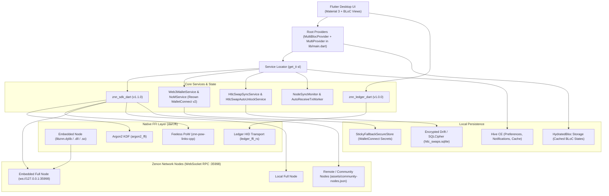

# System Architecture

Syrius is a single Flutter desktop application (`zenon_syrius_wallet_flutter`) designed to talk directly to Network of Momentum Phase 1 through an embedded `go-zenon` full node, a local node, or a remote community node.

## High-Level Component Diagram

## Startup Lifecycle & Dependency Injection (`lib/main.dart`)

Application bootstrap is centralized in `lib/main.dart`:

1. **Flutter & BLoC initialization** — Calls `WidgetsFlutterBinding.ensureInitialized()` and installs `CustomBlocObserver` (`lib/rearchitecture/utils/bloc_observers/custom_bloc_observer.dart`) as `Bloc.observer`. On Windows, registers the custom deep-link URL scheme via `registerProtocolHandler(kDeepLinkingUrlScheme)`.
2. **Data directory configuration** — Calls `_configureZnnDataDirectories()` and `ensureDirectoriesExist()`. Passing `--dart-define=ZNN_DATA_DIRECTORY=<dir>` redirects the wallet, cache, log, and `HydratedBloc` directories into a sibling folder for isolated testing (used by the `devnet-alice` and `devnet-bob` run configurations).
3. **Storage & Logging** — Initializes `HydratedBloc.storage`, calls `Hive.init(znnDefaultPaths.cache.path)`, registers Hive adapters (`Hive.registerAdapters()`), and opens a timestamped file logger under `<cache>/log/syrius-<epochMs>.log`.
4. **Window, Tray & Notifications** — Initializes `window_manager` with `setPreventClose(true)`, minimum window size `1200x600`, saved window geometry restoration, native desktop notifications (`flutter_local_notifications`), and the system tray menu (`Show wallet`, `Hide wallet`, `Exit wallet`).
5. **Service Locator (`get_it`)** — Calls `setup()`, which registers core singletons in `final GetIt sl = GetIt.instance`:
   - `Zenon` client (`sl<Zenon>()`), also exposed via the top-level `zenon` global
   - `NodeSyncMonitor`, `SharedPrefsService` (lazy async singleton)
   - `HtlcSwapLocalStorageApi`, `HtlcSwapRepository`, `LegacyHtlcSwapsMigrator`
   - `IWeb3WalletService` (`Web3WalletService`) and per-chain `IChain` (`NoMService`) instances for every `NoMChainId`
   - Long-lived BLoCs and workers: `LatestTransactionsBloc`, `PendingTransactionsBloc`, `MultipleBalanceBloc`, `AutoReceiveTxWorker`, `NotificationsBloc`, `PowGeneratingStatusBloc`
   - HTLC background services: `HtlcSwapUnlockService`, `HtlcSwapAutoUnlockService`, `HtlcSwapSyncService`
   - Embedded node lifecycle channels (`embeddedStoppedPort`, `embeddedStoppedStream`)
6. **Community Nodes & WalletConnect** — Loads and validates `assets/community-nodes.json` into `kDefaultCommunityNodes`, and launches an infinite network-error retry loop for `web3WalletService.init()`.
7. **Root Widget Tree (`MyApp`)** — Wraps `MaterialApp` in:
   - `MultiBlocProvider` (`buildMyAppBlocProviders()`): provides `NotificationsBloc`, `LatestTransactionsBloc`, `PendingTransactionsBloc`, `SendTransactionBloc`, `MultipleBalanceBloc`, `AllTokensBloc`, and `PlasmaStatsBloc`.
   - `MultiProvider`: provides `SelectedAddressNotifier`, `PlasmaBeneficiaryAddressCubit`, `PlasmaGeneratedNotifier`, `TextScalingNotifier`, `AppThemeNotifier`, `AppUiPreferencesNotifier`, and `LockBloc`.
   - Pointer, hover, and keyboard listeners that dispatch `LockTimerResetRequested` to `LockBloc` for inactivity auto-locking.

### Graceful Shutdown (`_MyAppState.onWindowClose`)

Because `windowManager.setPreventClose(true)` is enabled, closing the window runs an ordered shutdown sequence:

1. Persists window maximized state, width, height, and position to `SharedPrefsService`.
2. Stops `sl<Zenon>().wsClient`.
3. Starts a 60-second failsafe timer (`exit(0)`) so a hung isolate cannot strand the process.
4. Stops `HtlcSwapSyncService` and closes the encrypted `HtlcSwapLocalStorageApi` SQLite connection.
5. Stops the embedded `go-zenon` node via `NodeUtils.closeEmbeddedNode()`.
6. Resets `get_it` (`sl.reset()`), disposes resources, and exits cleanly.

## Embedded Node & Native FFI Libraries

Syrius integrates four native FFI libraries across desktop platforms:

### Embedded `go-zenon` Full Node (`lib/embedded_node/`)

`lib/embedded_node/embedded_node.dart` loads `libznn.dylib` (macOS), `libznn.dll` (Windows), or `libznn.so` (Linux) from `lib/embedded_node/blobs/` (or the packaged app bundle's `Resources`/executable directory) via `DynamicLibrary.open`.

- Looks up two C symbols: `RunNode` and `StopNode`.
- Runs the embedded node inside a dedicated Dart isolate (`EmbeddedNode.runNode`) so the node event loop never blocks the Flutter UI isolate.
- Registers the isolate's command `SendPort` in `IsolateNameServer` under the name `'embeddedIsolate'`; `EmbeddedNode.stopNode()` sends a stop signal to invoke `StopNode` cleanly.
- Connects to the embedded node over local WebSocket RPC at `ws://127.0.0.1:35998` (`kLocalhostDefaultNodeUrl`).

### Cryptographic, PoW, and Hardware FFI Libraries

- **[`argon2_ffi`](https://github.com/zenon-network/argon2_ffi)** — Argon2 key derivation used by `znn_sdk_dart` to encrypt/decrypt wallet keystore files.
- **[`znn-pow-links-cpp`](https://github.com/zenon-network/znn-pow-links-cpp)** — Native Proof-of-Work generator used when an account lacks fused QSR Plasma for a transaction.
- **[`ledger_ffi_rs`](https://github.com/zenon-network/ledger_ffi_rs)** — Rust FFI bridge used by `znn_ledger_dart` to communicate with Ledger devices over USB HID (`hidapi`).

## Local Persistence

Syrius separates local storage by durability, encryption, and query requirements:

### Hive CE (`lib/hive/`, `lib/services/shared_prefs_service.dart`)

Used for fast key-value preferences, address books, notification history, and UI caches inside `znnDefaultPaths.cache.path`.

- Type adapters are declared in `lib/hive/hive_adapters.dart` (`WalletNotification` with TypeID `100`, `NotificationType` with TypeID `101`) and generated into `lib/hive/hive_adapters.g.dart` and `lib/hive/hive_registrar.g.dart`.
- Box names are centralized in `lib/utils/constants.dart`: `shared_prefs_box`, `addresses_box`, `address_labels_box`, `notifications_box`, `favourite_tokens_box`, `recipient_address_box`, `nodes_box`, `key_store_box`, and `last_checked_htlc_block_box`.

### Encrypted Drift / SQLCipher (`lib/rearchitecture/features/p2p_swaps/data/`)

HTLC P2P swap records contain secret preimages and require indexed queries by chain ID, swap state, hash lock, and HTLC ID. Syrius stores them in an encrypted SQLite database (`htlc_swaps.sqlite`) powered by `drift` and `sqlite3` built with **SQLite3MultipleCiphers** (`hooks.user_defines.sqlite3.source: sqlite3mc` in `pubspec.yaml`):

- **`HtlcSwapsDatabase`** (`schemaVersion = 1`) opens with SQLCipher compatibility (`PRAGMA cipher = 'sqlcipher'; PRAGMA legacy = 4; PRAGMA hexkey = ...`) using a 32-byte encryption key and supports live key rotation via `rekey()`.
- **Tables**: `HtlcSwapEntries` (`htlc_swaps`, with indexes on `(chainId, state)`, `hashLock`, `initialHtlcId`, `counterHtlcId`, and `(chainId, startTime)`) and `HtlcScanCheckpoints` (`chainId -> lastCheckedHeight`).
- **Schema snapshots**: Committed under `drift_schemas/htlc_swaps_database/drift_schema_v1.json` (configured in `build.yaml`).
- **Legacy migration**: `LegacyHtlcSwapsMigrator` migrates swaps from the older Hive `htlc_swaps_box` into the encrypted Drift database.

### HydratedBloc Storage

`FetchBloc` and `InfiniteListBloc` extend `HydratedBloc`, caching serialized view state on disk so cards render immediately on reopen while fresh RPC data loads in the background.

## WalletConnect / Reown Services (`lib/services/`)

Syrius implements WalletConnect v2 dApp signing using Reown (`reown_walletkit: 1.5.1`, `reown_core: 1.5.1`) under the `zenon` namespace (`kZenonNameSpace`):

- **`IWeb3WalletService` / `Web3WalletService`** — Manages pairings, active sessions, pending session requests, and `addressChange` / `chainIdChange` events.
- **`DesktopSigningWalletKit`** — Adapts Reown's `ReownWalletKit` signing flows for desktop.
- **`NoMService` (`IChain`)** — Registered per `NoMChainId` in `get_it`; handles Zenon-specific RPC requests (account info, signing messages, sending transactions).
- **`StickyFallbackSecureStore`** — Wraps `flutter_secure_storage` with a resilient fallback strategy for desktop keychain availability edge cases.

## Dependency Pinning Gotchas (`pubspec.yaml`)

:::warning Do not casually alter SDK pins in `pubspec.yaml`
1. **`znn_sdk_dart` + `dependency_overrides`**: `pubspec.yaml` pins `znn_sdk_dart` to tag `v1.1.0` on `zenon-network/znn_sdk_dart` and repeats that exact ref under `dependency_overrides`. This is required because `znn_ledger_dart` (`v1.0.0`) transitively pins `znn_sdk_dart` `v1.0.0`. Removing the override causes version-solving failure until `znn_ledger_dart` updates its SDK ref.
2. **`fl_chart` commit pin**: `fl_chart` is pinned to commit `f3a575827312b8f12628b66d12d08066eb4d2570` on `imaNNeo/fl_chart` to fix a desktop UI chart issue until a release newer than `1.2.0` ships the fix.
3. **`sqlite3mc` build hook**: The `hooks.user_defines.sqlite3.source: sqlite3mc` block in `pubspec.yaml` is mandatory so SQLite compiles with SQLite3MultipleCiphers; without it, `HtlcSwapsDatabase.encrypted` throws `UnsupportedError`.
:::
