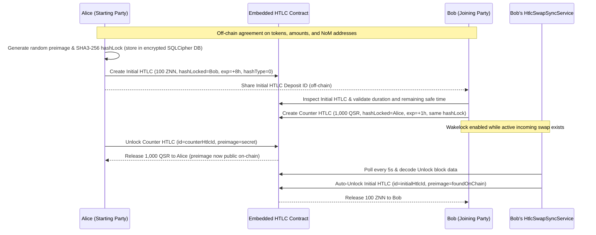

# P2P Swaps HTLC Protocol

Syrius implements censorship-resistant, fee-free, peer-to-peer ZTS token swaps using the **Network of Momentum embedded HTLC (Hash Time-Locked Contract)**. Because swaps settle directly through the embedded HTLC contract, neither party takes custody of the other's funds at any point.

:::tip Looking for the end-user walkthrough?
If you want step-by-step UI instructions for starting, joining, or reclaiming a swap in Syrius, read the [P2P Swaps User Guide](/docs/user-guide/core-features/p2p-swaps).
:::

## Protocol Flow

A P2P swap coordinates **two HTLCs** sharing the same SHA3-256 `hashLock`—an **initial HTLC** created by the starting party (Alice) and a **counter HTLC** created by the joining party (Bob).



If either party backs out before completion, both deposits remain timelocked and can be recovered via the HTLC contract's `Reclaim` method once their respective expiration timestamps pass.

## Timing Constants & Safety Invariants

All protocol timing constants are defined in `lib/utils/constants.dart`:

```dart
const Duration kInitialHtlcDuration = Duration(hours: 8);
const Duration kCounterHtlcDuration = Duration(hours: 1);
const Duration kMaxAllowedInitialHtlcDuration = Duration(hours: 24);
const Duration kMinSafeTimeToFindPreimage = Duration(hours: 6);
const Duration kMinSafeTimeToCompleteSwap = Duration(minutes: 10);
const int kMaxP2pSwapsToStore = 500;
```

| Constant | Value | Safety Purpose |
| --- | --- | --- |
| `kInitialHtlcDuration` | `8 hours` | Expiration offset from `frontierMomentumTime` when the starting party creates the initial HTLC. |
| `kCounterHtlcDuration` | `1 hour` | Expiration offset from `frontierMomentumTime` when the joining party creates the counter HTLC. |
| `kMaxAllowedInitialHtlcDuration` | `24 hours` | Upper bound on initial HTLC duration accepted by the joining party's validation checks. |
| `kMinSafeTimeToFindPreimage` | `6 hours` | Minimum buffer guaranteed between counter HTLC expiry and initial HTLC expiry so the joining party can observe the published preimage and unlock. |
| `kMinSafeTimeToCompleteSwap` | `10 minutes` | Safety margin before counter HTLC expiry after which the starting party will not initiate `Unlock`. |

### Why These Windows Matter

- **1-hour join window**: Because the initial HTLC lasts `8 hours`, the counter HTLC lasts `1 hour`, and Syrius requires at least `kMinSafeTimeToFindPreimage + kCounterHtlcDuration` (`7 hours`) remaining on the initial HTLC before allowing a user to join, the joining party has **1 hour** after initial creation to deposit the counter HTLC.
- **50-minute completion window**: Although the counter HTLC lasts `1 hour`, the starting party must submit `Unlock` at least `10 minutes` (`kMinSafeTimeToCompleteSwap`) before it expires. This prevents a race where the unlock transaction publishes the secret preimage on-chain, yet gets processed after the counter HTLC expires—which would let the joining party learn the preimage and claim the initial HTLC while reclaiming the counter HTLC.
- **6-hour recovery margin**: Even if the joining party's machine loses power or Syrius closes right after creating the counter HTLC, the joining party still has at least **6 hours** (`kMinSafeTimeToFindPreimage`) to reopen Syrius so `HtlcSwapSyncService` can scan the HTLC chain, recover the preimage, and unlock the initial HTLC.

## Embedded HTLC Contract Inputs

### 1. Starting the Swap (Initial HTLC `Create`)

When Alice starts a swap depositing `100 ZNN` (`10000000000` base units with 8 decimals) for Bob:

```text
hashLocked: ${joiningPartyAddress}
expirationTime: ${frontierMomentumTime} + ${kInitialHtlcDuration}
tokenStandard: zts1znnxxxxxxxxxxxxx9z4ulx
amount: 10000000000
hashType: 0
keyMaxSize: 255
hashLock: [32-byte SHA3-256 hash of a random preimage generated by Syrius]
```

- `hashType: 0` specifies **SHA3-256**.
- `keyMaxSize: 255` caps the maximum preimage byte length accepted on unlock.
- The generated preimage is persisted locally in the encrypted SQLCipher database (`htlc_swaps.sqlite`).

### 2. Joining the Swap (Counter HTLC `Create`)

After validating that the initial HTLC's duration does not exceed `kMaxAllowedInitialHtlcDuration` (24 hours) and its remaining lifetime is at least `kMinSafeTimeToFindPreimage + kCounterHtlcDuration` (7 hours), Bob creates the counter HTLC depositing `1,000 QSR` (`100000000000` base units with 8 decimals):

```text
hashLocked: ${startingPartyAddress}
expirationTime: ${frontierMomentumTime} + ${kCounterHtlcDuration}
tokenStandard: zts1qsrxxxxxxxxxxxxxmrhjll
amount: 100000000000
hashType: 0
keyMaxSize: 255
hashLock: ${initialHtlcHashlock}
```

If Bob never joins, Alice waits until the initial HTLC expires (8 hours) and calls `Reclaim`.

### 3. Completing the Swap — Starting Party (`Unlock`)

Once Alice observes Bob's valid counter HTLC, she completes the swap by calling the embedded HTLC contract's `Unlock` method:

```text
id: ${counterHtlcId}
preimage: ${preimageFromLocalStorage}
```

If Alice does not complete the swap within the 50-minute safe window, both parties wait for their respective HTLCs to expire and reclaim their deposits.

### 4. Auto-Unlocking — Joining Party (`Unlock`)

Once Alice's `Unlock` block confirms, the secret `preimage` is public in the HTLC contract's paired send block data. Bob's Syrius automatically extracts the preimage and calls `Unlock` on the initial HTLC:

```text
id: ${initialHtlcId}
preimage: ${preimageFoundOnChain}
```

## Syrius Implementation Architecture (`lib/rearchitecture/features/p2p_swaps/`)

### Encrypted Local Storage (`HtlcSwapsDatabase`)

Swap metadata and secret preimages are persisted in `htlc_swaps.sqlite` using Drift + SQLite3MultipleCiphers (`lib/rearchitecture/features/p2p_swaps/data/htlc_swaps_database.dart`):

- Encrypted with a 32-byte key via `PRAGMA cipher = 'sqlcipher'; PRAGMA legacy = 4; PRAGMA hexkey = ...`.
- Stores two tables: `htlc_swaps` (`HtlcSwapEntries`) and `htlc_scan_checkpoints` (`HtlcScanCheckpoints`), tracking the last processed HTLC account-block height per `chainId`.
- All storage and RPC exceptions are passed through `swap_storage_error_sanitizer.dart` (`formatSafeSwapErrorSummary` / `sanitizeSwapErrorForLogging`) before logging so SQL bind parameters containing secret HTLC preimages are never written to log files.

### Background Sync & Auto-Unlock Services

1. **`HtlcSwapSyncService`** (`htlc_swap_sync_service.dart`):
   - Polls every **5 seconds** (`_kPollInterval`) while the WebSocket client is connected and unresolved swaps (`pending`, `active`, `reclaimable`) exist.
   - Compares the HTLC contract's frontier height (`zenon.ledger.getFrontierAccountBlock(htlcAddress)`) against the stored checkpoint and decodes new `contractReceive` blocks using `Definitions.htlc`.
   - Handles `Create` (marks pending swaps active and validates incoming counter HTLCs by checking `hashLocked`, creator `address`, `hashType`, and `expirationTime`), `Unlock` (extracts hex `preimage` and marks completed swaps), and `Reclaim` (marks swaps `unsuccessful`).
   - Transitions expired swaps to `reclaimable`—and continues scanning `reclaimable` incoming swaps for preimages in case the counterparty published the preimage at the last moment before expiry.
2. **`HtlcSwapAutoUnlockService`** (`htlc_swap_auto_unlock_service.dart`):
   - Unlocks eligible incoming swaps sequentially (one at a time) once `NodeSyncMonitor.isNodeSynced()` returns `true` and the wallet keystore is loaded (`kWalletFile != null`).
   - Enforces a **2-minute per-swap retry cooldown** (`_kRetryCooldown`) and dispatches desktop/in-app notifications via `NotificationsBloc`.

## Wakelock & HTLC Watchtowers

:::caution Risk of failing to discover the preimage
If the joining party fails to discover the published preimage and unlock the initial HTLC before it expires, the starting party can reclaim the initial deposit—resulting in a loss of funds for the joining party.
:::

To mitigate this risk:

- **Automatic Display Wakelock**: While any incoming swap is in `P2pSwapState.active`, `HtlcSwapSyncService._enableWakelockIfNeeded()` calls `WakelockPlus.enable()` (`wakelock_plus`) to request a display wakelock during the 1-hour counter-HTLC window. Because `wakelock_plus` does not hold a CPU wake lock or guarantee blocking OS system sleep across all platforms, users should still disable OS idle sleep while a swap is pending.
- **HTLC Watchtowers**: Community members can deploy [HTLC Watchtowers (`hypercore-one/htlc-watchtower`)](https://github.com/hypercore-one/htlc-watchtower) to monitor the HTLC contract and relay unlocks even if a user's wallet is offline.

## Extensibility & Future Direction

The `P2pSwap` domain model (`lib/rearchitecture/features/p2p_swap/model/p2p_swap.dart`) abstracts `P2pSwapType`, `P2pSwapChain`, and `P2pSwapMode` so the underlying swap primitive can evolve without breaking the wallet UX. While Syrius currently supports same-chain ZTS-to-ZTS swaps on Network of Momentum, HTLCs also provide a foundation for future cross-chain atomic swaps.
