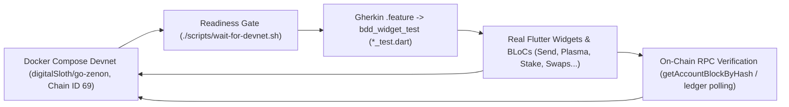

# Blockchain Integration Tests

Blockchain integration tests validate Syrius wallet behavior against a real, isolated **Dockerized `go-zenon` devnet node**. Rather than calling SDK methods directly, these tests drive real Flutter UI widgets and BLoCs, sign transactions with an in-memory devnet wallet, broadcast account blocks to the node, and poll the blockchain to assert that on-chain state matches the exact values typed into the UI.

## Architecture & Execution Flow



## BDD Scope & Separation from Unit Tests

Syrius enforces a strict split between mocked tests and live-chain BDD tests:

```text
test/
  Fast mocked Dart tests for BLoCs, Cubits, validators, serializers,
  repositories, services, and small widgets (no Gherkin).

integration_test/
  Gherkin .feature scenarios and generated *_test.dart files tagged @chain
  that drive wallet UI flows against a Dockerized devnet node.
```

- **Use Gherkin (`bdd_widget_test`)** only for high-level wallet journeys with real on-chain effects.
- **Avoid Gherkin** for BLoC unit tests, input validators, JSON serialization, utilities, or rendering-only widget tests.

### Implemented `@chain` Feature Suites (`integration_test/features/`)

Syrius currently maintains **8** Gherkin feature suites under `integration_test/features/`:

| Feature File | On-Chain Flow Verified |
| --- | --- |
| `send_transaction.feature` | Sending ZNN from the Send screen and verifying the confirmed send block on-chain |
| `fuse_plasma.feature` | Fusing QSR from the Fuse Plasma card and verifying the published fuse block |
| `create_stake.feature` | Creating a ZNN stake and verifying the on-chain stake entry |
| `create_token_stepper.feature` | Issuing a ZTS token through the Create Token stepper and checking the issue block |
| `create_pillar_stepper.feature` | Creating a Pillar via the Create Pillar stepper and verifying Pillar registration |
| `create_sentinel_stepper.feature` | Registering a Sentinel via the Create Sentinel stepper and verifying Sentinel state |
| `p2p_swap_htlc.feature` | Full two-party HTLC P2P swap: start, join, complete, automatic counterparty unlock, and on-chain verification |
| `submit_accelerator_project_and_vote.feature` | Submitting an Accelerator-Z project and recording Pillar Yes/No votes on-chain |

### Example Feature File (`send_transaction.feature`)

```gherkin
@chain
Feature: Send ZNN on devnet

  Scenario Outline: Sending ZNN from the wallet UI is recorded on-chain
    Given <sender> address has funds
    When I send <amount> ZNN from <sender> address to <recipient> address from the Send screen
    Then the blockchain should contain that <amount> ZNN transfer to <recipient>

    Examples:
      | sender                                      | recipient                                   | amount  |
      | 'z1qp3yph55qgresyytz83anynr2f4z39x2z3ej3e'  | 'z1qpeet8dcjg0m6x6m3tg437wnc42aa2nez2fzth'  | '0.001' |
```

## BDD Configuration (`build.yaml` & `dart_test.yaml`)

`bdd_widget_test` (`^2.1.4`) converts Gherkin `@chain` tags into Dart `@Tags(['chain'])` metadata. The custom `chain` tag is declared in `dart_test.yaml`:

```yaml
tags:
  chain:
```

`build.yaml` configures `bdd_widget_test|featureBuilder` to read `integration_test/**`, emit shared step definitions into `integration_test/steps`, and generate lifecycle hooks into `integration_test/bdd_hooks`:

```yaml
targets:
  $default:
    sources:
      - integration_test/**
      - test/**
      - lib/**
      - $package$
    builders:
      bdd_widget_test|featureBuilder:
        options:
          addHooks: true
          hookFolderName: integration_test/bdd_hooks
          relativeToTestFolder: false
          stepFolderName: integration_test/steps
```

### Committed Generated BDD Files Policy

Generated `integration_test/features/*_test.dart` files are **committed to the repository**. Whenever you edit a `.feature` file, step definition, or BDD hook, regenerate and format locally before pushing:

```bash
dart run build_runner build --delete-conflicting-outputs
dart format integration_test
```

:::warning Do not manually edit generated `*_test.dart` files
`.github/workflows/blockchain-integration-tests.yml` intentionally does **not** run `build_runner`—it executes the committed generated tests directly, while `.github/workflows/pr-validation.yml` fails if `dart run build_runner build && dart format integration_test` produces any diff.
:::

## Docker Devnet & Environment Variables

Both local runs and CI use the pinned Docker Compose devnet from [`digitalSloth/go-zenon`](https://github.com/digitalSloth/go-zenon/tree/bca9d950b07d379ff09a9a5aa74b09ce0fa92b3f) (commit `bca9d950b07d379ff09a9a5aa74b09ce0fa92b3f`), which exposes a clean genesis with Chain ID `69` and pre-funded deterministic accounts.

Configure test runs through these environment variables:

```bash
ZNN_TEST_HTTP_URL=http://127.0.0.1:35997
ZNN_TEST_NODE_URL=ws://127.0.0.1:35998
ZNN_TEST_MNEMONIC="abstract affair idle position alien fluid board ordinary exist afraid chapter wood wood guide sun walnut crew perfect place firm poverty model side million"
ZNN_TEST_PASSWORD=devnet
ZNN_TEST_SENDER_INDEX=3
ZNN_TEST_RECIPIENT_INDEX=8
```

:::danger Devnet-only credentials
The mnemonic and password above are **publicly committed devnet test values** from the Docker devnet setup. Never reuse them on Zenon mainnet or with real funds.
:::

## Running Integration Tests Locally

1. **Start the Dockerized devnet** from a local checkout of the pinned `digitalSloth/go-zenon` commit:

   ```bash
   git clone https://github.com/digitalSloth/go-zenon.git ../go-zenon-devnet
   cd ../go-zenon-devnet
   git checkout bca9d950b07d379ff09a9a5aa74b09ce0fa92b3f
   make devnet-up
   ```

2. **Wait for devnet readiness** from the `syrius` repo root using `./scripts/wait-for-devnet.sh`:

   ```bash
   ZNN_TEST_HTTP_URL=http://127.0.0.1:35997 \
   ./scripts/wait-for-devnet.sh
   ```

   The wait script verifies three conditions before exiting `0`:
   - `ledger.getFrontierMomentum` responds with `chainIdentifier: 69`
   - `stats.syncInfo` reports `SyncState.syncDone` (`state: 2`)
   - A fresh momentum has been produced beyond the initial height

3. **Run one or all `@chain` integration tests** against your desktop target (`macos`, `windows`, or `linux`):

   ```bash
   export ZNN_TEST_HTTP_URL=http://127.0.0.1:35997
   export ZNN_TEST_NODE_URL=ws://127.0.0.1:35998
   export ZNN_TEST_MNEMONIC="abstract affair idle position alien fluid board ordinary exist afraid chapter wood wood guide sun walnut crew perfect place firm poverty model side million"
   export ZNN_TEST_PASSWORD=devnet
   export ZNN_TEST_SENDER_INDEX=3
   export ZNN_TEST_RECIPIENT_INDEX=8

   # Run a single feature suite
   flutter test integration_test/features/send_transaction_test.dart -d <macos|windows|linux> --tags chain

   # Or run all feature suites sequentially
   for test_file in integration_test/features/*_test.dart; do
     flutter test "$test_file" -d <macos|windows|linux> --tags chain
   done
   ```

4. **Shut down the devnet** when finished:

   ```bash
   cd ../go-zenon-devnet && make devnet-down
   ```

## CI Execution (`.github/workflows/blockchain-integration-tests.yml`)

The **Blockchain Integration Tests** workflow triggers on pull requests targeting `develop` and via manual `workflow_dispatch`:

- Runs on `ubuntu-24.04` with both `syrius` and `digitalSloth/go-zenon@bca9d950b07d379ff09a9a5aa74b09ce0fa92b3f` checked out in the same job (so the Flutter test runner can reach `127.0.0.1:35997` and `127.0.0.1:35998` locally).
- Boots the devnet via `make devnet-up`, installs Flutter `3.47.6` and Linux desktop + `xvfb` packages, and waits for readiness via `./scripts/wait-for-devnet.sh`.
- Executes every `integration_test/features/*_test.dart` file sequentially under Xvfb:

  ```bash
  for test_file in integration_test/features/*_test.dart; do
    xvfb-run -a flutter test "$test_file" -d linux --tags chain
  done
  ```

- On failure, dumps `docker compose logs --no-color`, and always tears down the devnet via `make devnet-down || true`.

## Security-Focused Assertions & Reliability Rules

When writing new blockchain integration tests, follow these rules from `docs/testing/blockchain-integration-tests.md`:

- **Verify UI-to-chain integrity**: Capture the account-block hash returned by the BLoC, fetch it with `zenon.ledger.getAccountBlockByHash(hash)`, and assert that the fetched block exists and matches the hash, recipient, amount, and token standard entered into the UI.
- **Use stable widget `Key`s**: Attach deterministic `Key`s to interactive fields and buttons so tests never break when localized copy or layout changes.
- **Poll for eventual consistency**: Account blocks and momentum confirmations are asynchronous; always poll with clear timeouts and diagnostic failure messages.
- **Avoid sender nonce races**: Run feature files sequentially (as CI does) and avoid executing concurrent transactions from the same sender address.
- **Prefer balance deltas and unique recipients**: Assert balance deltas rather than hardcoded absolute balances whenever chain state may persist across scenarios.
- **Keep tests focused**: Avoid a shared external devnet for PR checks; every CI run must start from a clean local Docker devnet genesis.
